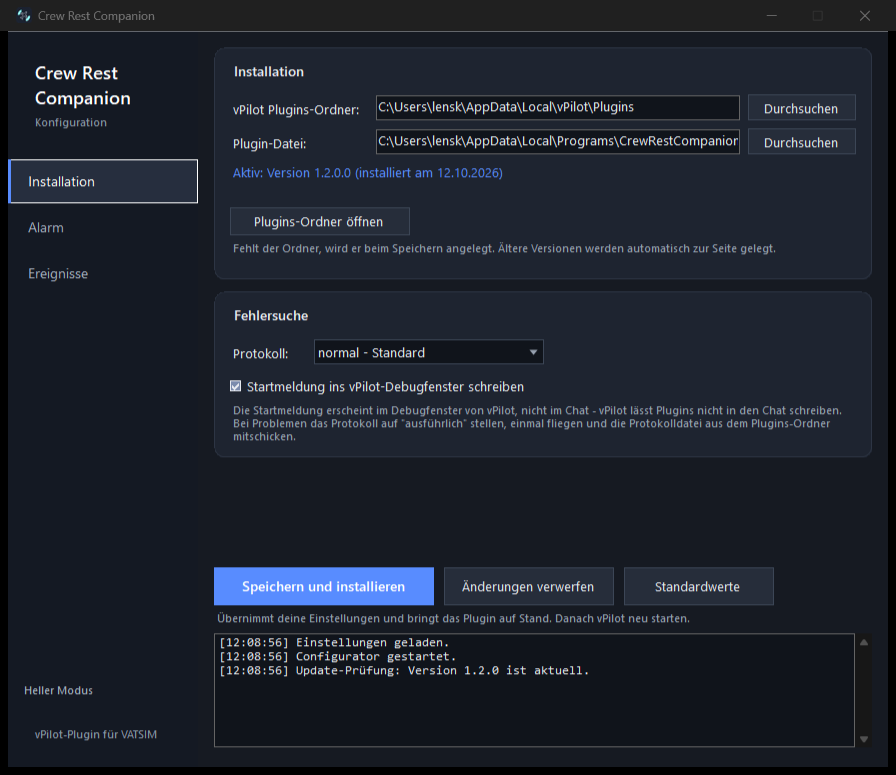

# Crew Rest Companion

**Ein vPilot-Plugin für VATSIM, das dich weckt, wenn ATC dich ruft – und dich in Ruhe lässt, wenn nicht.**

[](LICENSE)
[](https://github.com/schleicher45/CrewRestCompanion/actions/workflows/build.yml)
[](https://github.com/schleicher45/CrewRestCompanion/releases/latest)

## ⬇️ Herunterladen

### ➜ **[Setup herunterladen](https://github.com/schleicher45/CrewRestCompanion/releases/latest)**

Auf der Seite, die sich öffnet, unter **Assets** die Datei
`CrewRestCompanion-Setup-1.2.0.exe` anklicken – das ist das Installationsprogramm.
Herunterladen, doppelklicken, fertig.

> Der grüne Knopf **Code** oben auf dieser Seite lädt den Quelltext als ZIP.
> Den brauchst du nur, wenn du das Programm selbst bauen oder nachlesen willst –
> ausführen lässt er sich nicht.

### 📖 **[Anleitung als PDF](docs/Anleitung.pdf)**

16 Seiten, bebildert: Einrichtung in vier Schritten, alle Einstellungen erklärt und
eine Fehlersuche, die dich Schritt für Schritt zur Ursache führt.

Auf Langstrecke ist der Rechner stundenlang sich selbst überlassen. Wer in der Zeit etwas anderes
macht oder schläft, verpasst ein „contact me" – und steht am Ende als unerreichbar im Netz.
Der Crew Rest Companion überwacht vPilot und schlägt genau dann Alarm, wenn es nötig ist.



---

## Was es meldet

| Ereignis | Reaktion |
|---|---|
| Nachricht von einem **Supervisor** | Alarm |
| Private Nachricht von einem **Lotsen** | Alarm |
| **„contact me"** in einer Nachricht | Alarm |
| **SELCAL-Ruf** | Alarm |
| **Funkspruch mit deinem Callsign** auf der gerasteten Frequenz | Alarm |
| Private Nachricht eines **Piloten** | leise Info (abschaltbar) |
| **Lotse geht online** (mit Präfix-Filter) | leise Info (abschaltbar) |

**Alarm** heißt: Dauerton aufs Handy, der Lautlos und „Nicht stören" durchbricht – und auf Wunsch
zusätzlich eine E-Mail, die auf dem iPhone einen Wecker auslöst.
**Leise Info** heißt: normale Push-Nachricht, die niemanden aus dem Schlaf reißt.

## Wie es dich erreicht

Zwei Wege, einzeln oder zusammen:

**Bark** (iOS, kostenlos) – Push-Nachricht mit Critical Alert. Durchbricht Lautlos und
„Nicht stören" und klingelt durch, bis du sie wegwischst.

**E-Mail-Wecker** – das Plugin schickt eine Mail mit dem Betreff `ALARM-VPILOT`. Auf dem iPhone
startet ein Kurzbefehl daraufhin einen Timer, der läuft, bis du ihn ausschaltest. Der sicherste
Weg, aber er braucht ein Mailkonto mit Push (Outlook ja, Gmail und GMX meist nicht).

## Installation

1. [Neueste Version herunterladen](https://github.com/schleicher45/CrewRestCompanion/releases/latest)
   und `CrewRestCompanion-Setup-x.y.z.exe` ausführen.
   *Windows zeigt „Unbekannter Herausgeber" – das Setup ist nicht signiert.
   Auf „Weitere Informationen" → „Trotzdem ausführen".*
   Wer kein Setup möchte, nimmt das ZIP aus demselben Release und startet
   `CrewRestConfigurator.exe` direkt – es installiert das Plugin genauso.
2. Der **Configurator** öffnet sich. Dort Bark-Key oder Mailkonto eintragen und auf
   **Speichern und installieren** klicken. Das Programm legt den vPilot-Plugins-Ordner an,
   kopiert die DLL hinein und schreibt die `config.txt`.
3. **vPilot neu starten.**
4. Mit **Test ALARM** prüfen, ob das Handy klingelt – ohne dass du dafür online gehen musst.

Die vollständige Anleitung mit Bildern gibt es als **[PDF](docs/Anleitung.pdf)**;
als Textfassung steht sie in [docs/ANLEITUNG.md](docs/ANLEITUNG.md).

### Voraussetzungen

* vPilot 3.x unter Windows
* .NET Framework 4.8 (auf Windows 10 und 11 bereits vorhanden)
* ein iPhone mit Bark **oder** ein Mailkonto mit Push

## Konfiguration

Alles lässt sich im Configurator einstellen; die `config.txt` liegt im Plugins-Ordner und kann
auch von Hand bearbeitet werden.

| Schlüssel | Bedeutung | Standard |
|---|---|---|
| `BarkDeviceKey` | Device Key aus der Bark-App | leer |
| `BarkServerUrl` | eigener Bark-Server | `https://api.day.app/` |
| `AlarmSound`, `AlarmLevel`, `AlarmVolume`, `AlarmCall` | Klingelton, Stufe, Lautstärke, Dauerton | `multiwayinvitation`, `critical`, `10`, `1` |
| `EmailAddress`, `EmailAppPassword` | Konto für den Mail-Wecker (Passwort verschlüsselt) | leer |
| `SmtpHost`, `SmtpPort`, `SmtpUseSsl` | Mailserver | `smtp.office365.com`, `587`, `true` |
| `CooldownS` | Sperrzeit nach einem Alarm | `60` |
| `AlarmOnSelcal`, `AlarmOnRadioMessage` | zusätzliche Auslöser | `true` |
| `NotifyPilotDMs` | leise Info bei Piloten-DMs | `false` |
| `NotifyControllerOnline`, `ControllerFilter` | Meldung bei neuen Lotsen, z. B. `EDDL,EDGG` | `false`, leer |
| `LogLevel` | `off`, `info` oder `debug` | `info` |

Das Mail-Passwort steht **verschlüsselt** in der Datei (Windows-DPAPI) und ist nur für denselben
Windows-Benutzer auf demselben PC lesbar. Die `config.txt` lässt sich also nicht samt Zugangsdaten
weitergeben.

## Updates

Der Configurator prüft beim Start, ob eine neuere Version vorliegt, und zeigt das links in der
Leiste an. Ein Update läuft so:

1. Neues Setup ausführen.
2. Configurator starten, **Speichern und installieren** klicken.
3. vPilot neu starten.

**Deine Einstellungen bleiben erhalten.** Sie liegen nicht im Programmordner, sondern in
`%localappdata%\vPilot\Plugins\config.txt` und `%appdata%\CrewRestCompanion\ui.txt`.
Unbekannte Schlüssel werden beim Speichern mitgenommen, neue bekommen ihren Standardwert.
Die abgelöste DLL wandert nach `_alte-versionen\` (höchstens drei).

vPilot muss beim Austausch der DLL geschlossen sein, sonst ist die Datei gesperrt – der
Configurator sagt das deutlich.

## Fehlersuche

**Das Plugin taucht in vPilot nicht auf.**
Liegt `CrewRestCompanion.dll` direkt in `%localappdata%\vPilot\Plugins` (nicht in einem
Unterordner)? Stammt sie aus einem ZIP, hat Windows sie eventuell gesperrt – der Configurator
entfernt diese Sperre beim Installieren.

**Es kommt keine Push-Nachricht.**
Im Configurator auf **Test ALARM** klicken. Kommt dort nichts an, stimmt der Device Key nicht.

**Die Mail kommt nicht.**
Fast immer das Login-Passwort statt eines App-Passworts. Bei Microsoft unter
account.microsoft.com → Sicherheit → App-Kennwörter eines erzeugen.

**Es klingelt, aber das iPhone bleibt stumm.**
Dann liegt es an iOS: „Push" muss unter Einstellungen → Mail → Accounts → Datenabgleich aktiv
sein, und die Automation im Kurzbefehl muss auf „Sofort ausführen" stehen.

Hilft nichts davon: im Configurator die Logdatei auf **ausführlich** stellen, einmal fliegen und
die `plugin.log` an ein [Issue](https://github.com/schleicher45/CrewRestCompanion/issues) hängen.

## Selbst bauen

```
git clone https://github.com/schleicher45/CrewRestCompanion.git
cd CrewRestCompanion
build.bat
```

Gebraucht wird Visual Studio 2022 (oder die Build Tools) mit .NET Framework 4.8.
Das Ergebnis landet in `dist\`.

Ist zusätzlich [Inno Setup](https://jrsoftware.org/isdl.php) installiert, baut `build.bat`
auch gleich die Setup-Datei nach `installer\Output\`. Fehlt es, sagt das Protokoll Bescheid
und der Rest wird trotzdem gebaut.

### Projektaufbau

| Ordner | Inhalt |
|---|---|
| `plugin/` | das vPilot-Plugin (DLL) |
| `configurator/` | das Konfigurationsprogramm (WinForms) |
| `installer/` | Inno-Setup-Skript |
| `lib/` | vPilot-Plugin-Schnittstelle, gegen die gebaut wird |
| `docs/` | Anleitung und Bilder |

## Lizenz

[MIT](LICENSE) – benutzen, ändern und weitergeben ausdrücklich erwünscht.

Bark ist ein eigenständiges Projekt und gehört nicht zu diesem Plugin.
vPilot stammt von Ross Carlson. Dieses Plugin ist kein offizielles VATSIM-Produkt.
